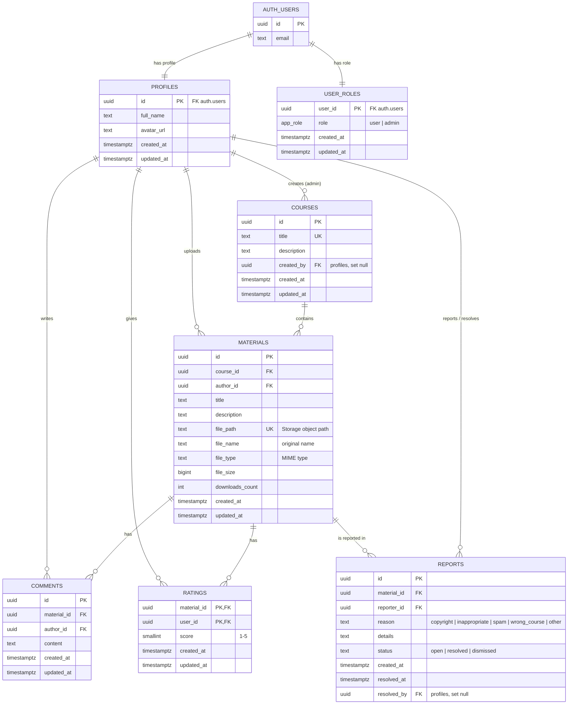

# StudyShare

A web app for sharing study materials by course. Students upload lecture notes, solved exercises and slides (PDF / DOCX / PPTX), download others' materials, comment and rate them, and share links to them. Admins manage courses, moderate content and assign roles.

Capstone project for the SoftUni course “Software Technologies with AI”, built with AI-assisted development (prompt → implement → test → refine → commit).

**Live demo:** https://studyshare-learn.netlify.app (demo accounts are listed [below](#demo-accounts)).

## Who can do what

| Action | Guest | User | Admin |
|---|:-:|:-:|:-:|
| Browse courses, materials, comments and ratings; share links | ✅ | ✅ | ✅ |
| Register, log in, log out | ✅ | — | — |
| Download files | — | ✅ | ✅ |
| Upload materials; edit / delete **own** materials | — | ✅ | ✅ |
| Comment (edit / delete **own** comments); rate others' materials 1–5 | — | ✅ | ✅ |
| Report another user's material (copyright, inappropriate, spam…) | — | ✅ | ✅ |
| Profile with avatar; personal dashboard | — | ✅ | ✅ |
| Create / edit / delete courses | — | — | ✅ |
| Delete **any** material or comment; review reports (moderation) | — | — | ✅ |
| Grant / revoke the admin role (not their own) | — | — | ✅ |

The browser only hides what a role cannot do; the real checks are **Row-Level Security policies** in the database.

## Features

- Browse courses and their materials (search, sorting by date, rating, downloads, title) — no login needed.
- Upload materials (PDF, Word, PowerPoint, Excel, TXT, ZIP up to 20 MB) to a course; edit or delete your own. The uploader confirms they are the author or have the right to share the material.
- Report a material („Сигнализирай“: copyright, inappropriate content, spam, wrong course); admins review the reports.
- Download files (logged-in users), with a download counter. PDFs can also be read in the browser first („Преглед“, rendered with pdf.js — works the same on desktop, Android and iOS; not counted as a download).
- Comment (add, edit, delete your own) and rate materials with 1–5 stars (not your own).
- Profile with avatar upload and name editing; personal dashboard with statistics.
- Share a material or course: native share sheet on phones, copy link (also for Discord), QR code (with PNG download), Facebook, X, LinkedIn, Reddit, Telegram, WhatsApp, Viber and e-mail. Shared links show a rich preview (title, description, image). Guests who open a shared link can browse it; downloading, commenting and rating still require login, and after login or registration they return to the same material.
- Admins: manage courses, moderate any material or comment, assign roles.

## Tech stack

- **Frontend:** HTML, CSS, vanilla JavaScript (ES modules), Bootstrap 5, Bootstrap Icons
- **Build:** Node.js, npm, Vite
- **Backend:** Supabase (Postgres DB, Auth, Storage)
- **Hosting:** Netlify

## Architecture (short)

- **Multi-page navigation** as in the course workshop (Taskboard): every screen is a separate page with its own URL (`/courses/:id`, `/materials/:id`, …) and its own files — not one page with popups. Back/Forward, reload and direct links work on every page.
- Single `index.html` shell + client-side router (`src/router.js`, History API) with clean URLs; header and footer are shared components.
- Each page is a separate folder in `src/pages/` (HTML fragment + CSS + JS), loaded on demand.
- All data access goes through services in `src/services/`; authorization is enforced by Supabase RLS.
- **Link previews:** social crawlers do not run JavaScript, so `netlify/edge-functions/link-preview.js` rewrites the Open Graph tags of `/materials/:id` and `/courses/:id` for crawler requests only (title and description are read from Supabase with the public key). Regular visitors are not affected; other pages use the static tags in `index.html` and `public/og-image.png`.

### Routes

| Route | Page | Access |
|---|---|---|
| `/` | Landing page | everyone |
| `/login`, `/register` | Login / registration | guests |
| `/dashboard` | User dashboard | users |
| `/courses`, `/courses/:id` | Courses and their materials | everyone |
| `/materials/add`, `/materials/:id/edit` | Upload / edit material | users |
| `/materials/:id` | Material details | everyone |
| `/profile` | My profile | users |
| `/admin?tab=users\|courses\|moderation` | Admin panel | admins |

### Admin panel

- **Overview:** totals for users, admins, courses, materials, comments and downloads.
- **Users:** list with email, role and activity, search and role filter; grant or revoke the admin role (with confirmation).
  An admin cannot change their own role, so at least one admin always remains.
- **Courses:** create, edit and delete. Deleting a course removes its materials, comments and ratings (DB cascade) and their files in Storage.
- **Moderation:** open reports (delete the reported material or dismiss the report), plus the latest 20 materials and comments site-wide, each deletable.

Security is enforced in the database, not in the browser:
- `admin_list_users()` and `admin_get_stats()` are `SECURITY DEFINER` functions that check `public.is_admin()` first. They return only the needed fields (emails come from `auth.users`, which clients cannot read).
- Role changes go through `user_roles` and its RLS policy (admins only, never on their own row). Users can never promote themselves.

## Local development

```bash
git clone https://github.com/plam13/studyshare.git
cd studyshare
npm install
cp .env.example .env   # fill in VITE_SUPABASE_URL and VITE_SUPABASE_PUBLISHABLE_KEY
npm run dev
```

## Deployment (Netlify)

- Build settings are in `netlify.toml` (`npm run build` → `dist/`); `public/_redirects` sends every route to `index.html`, so clean URLs such as `/materials/<id>` work on reload.
- Environment variables on Netlify: `VITE_SUPABASE_URL`, `VITE_SUPABASE_PUBLISHABLE_KEY` (public values only).
- Supabase Auth → URL configuration: Site URL `https://studyshare-learn.netlify.app`, redirect URLs for the live site and `http://localhost:5173/**`.
- Manual deploy with the Netlify CLI: `netlify deploy --build --prod`.
- **Free-plan credits:** each production deploy costs 15 of 300 monthly credits, so Netlify builds only when the last commit message contains `[deploy]` (`ignore` rule in `netlify.toml`). Test first with a free draft deploy: `netlify deploy --build` (without `--prod`).

## Files and storage

- `materials` bucket (private): object path `<uploader-id>/<uuid>-<safe-name>`; the original file name is kept in `materials.file_name` and used when downloading. Only logged-in users can download.
- `avatars` bucket (public): `<user-id>/avatar-<timestamp>.<ext>`; old avatar files are removed when replaced.
- Deleting or replacing a material also deletes its file — database cascades do not remove Storage objects.

## Database schema



- **`profiles`** is 1:1 with `auth.users` and is created by the `on_auth_user_created` trigger together with a default `user` row in **`user_roles`**. Roles never come from sign-up metadata.
- **`materials`**, **`comments`** and **`ratings`** are deleted in cascade with their course, material or author. Storage files are removed by the app (cascades do not delete Storage objects).
- **`ratings`** uses a composite primary key `(material_id, user_id)`, so each user rates a material at most once. An RLS policy blocks rating your own material.
- **`reports`** — one report per user per material (`unique (material_id, reporter_id)`). Users can report only other users' materials and see only their own reports; only admins see all and change the status, and a trigger records who closed the report and when.
- **`material_stats`** (view, `security_invoker`) aggregates the average rating, ratings count and comments count per material.
- **Indexes** on every foreign key (`course_id`, `author_id`, `material_id`, `user_id`, `created_by`), on `materials.created_at` for "latest" lists and on `user_roles.role`. Check constraints limit text lengths and the 1–5 score.
- **RLS** is enabled on every table; `public.is_admin()` is used by admin policies. Clients can update only allowed columns (column-level grants), e.g. never `author_id` or `downloads_count`.

## Database workflow

The DB schema is managed only through SQL migrations in `supabase/migrations/`, using the **Supabase CLI** linked to the remote project (`npx supabase link`). No schema changes are made by hand in the dashboard, so the migration files in this repo are the full history of the database.

```bash
npx supabase migration new <name>          # create a new SQL migration file
npx supabase db push --remote --dry-run    # preview what will be applied
npx supabase db push --remote              # apply it to the Supabase project
npx supabase migration list --remote       # check that local and remote history match
```

| Migration | What it does |
|---|---|
| `init_schema` | tables `profiles`, `user_roles`, `courses`, `materials`, `comments`, `ratings`, view `material_stats`, indexes |
| `rls_policies` | RLS on every table, `is_admin()` helper, column-level grants |
| `seed_admin_role` | assigns the admin role to the bootstrap admin account |
| `storage_buckets` | `avatars` (public) and `materials` (private) buckets and their policies |
| `dashboard_stats_rpc` | personal dashboard statistics function |
| `download_counter_rpc` | safe download counter increment |
| `ratings_no_self_rating` | users cannot rate their own materials |
| `admin_users_rpc` | admin-only user list and site statistics |
| `material_reports` | `reports` table, RLS, column grants and resolution trigger |

How the parts talk to Supabase:
- **Frontend:** `@supabase/supabase-js` (REST API) with the public publishable key; access is limited by RLS.
- **Schema:** Supabase CLI migrations (above).
- **Sample data:** the Node.js seed script below, using the secret key on the server side only.

## Sample data (seed)

The seed script creates demo users (through the Supabase Auth Admin API), courses, 30 materials with generated files in Storage, comments (including short discussions) and ratings. It is safe to rerun: existing records are skipped and passwords are never reset.

- **Files** are generated without extra dependencies (`scripts/lib/`): multi-page PDFs (some with "scanned notes" pages), DOCX, PPTX, XLSX, TXT and ZIP. Sizes range from about 2 KB to 2.4 MB, and every file opens in its usual program.
- **Dates** follow a semester: materials are spread from mid-September in curriculum order, and comments and ratings come after their material. All values are deterministic, so every run produces the same data.

```bash
cp .env.server.example .env.server.local   # server-side only: SUPABASE_URL, SUPABASE_SECRET_KEY, SEED_EXPECTED_PROJECT_REF
npm run seed:dry-run                        # shows what would be created, writes nothing
npm run seed                                # applies the seed
npm run seed:reset                          # deletes the demo materials (files, comments, ratings) and creates them again

# then align account and course dates with the materials (data only, not a migration)
npx supabase db query --remote -f scripts/sql/backdate-demo-accounts.sql
```

`seed:reset` touches only materials created by the seed (Storage path `<author>/seed-<key>.<ext>`), never content uploaded through the app.

> The secret key is used only by Node.js scripts in `scripts/`. It never has a `VITE_` prefix and never reaches the browser.

## Demo accounts

| Role | Email | Password |
|---|---|---|
| Admin | `admin@studyshare.bg` | `********` (provided in the project submission) |
| User | `demo@studyshare.bg` | `demo123` |
| User | `maria@studyshare.bg`, `peter@studyshare.bg`, `elena@studyshare.bg` | `pass123` |

**You can also register your own test account.** E-mail confirmation is **intentionally disabled** for this student project, so reviewers can sign up with any e-mail address (no message is sent) and are logged in immediately. Every new account gets the `user` role from a database trigger; roles never come from the sign-up data, so nobody can register as an admin.

For real use the following would be turned on in Supabase Auth: e-mail confirmation (the register page already has a "check your inbox" screen for it), leaked-password protection and a CAPTCHA on sign-up.

## Project structure

```
├── index.html             # app shell (+ static Open Graph tags)
├── AGENTS.md              # Agent Instructions for AI dev agents (project context, architecture, rules)
├── implementation-plan.md # stages of the AI-assisted implementation, status and remaining work
├── public/                # static assets: favicon, Netlify _redirects, robots.txt, og-image.png
├── src/
│   ├── main.js            # entry: global CSS/JS, layout, auth init, router start
│   ├── router.js          # routes, guards, mount/unmount
│   ├── styles.css         # global styles entry (imports src/styles/*)
│   ├── styles/            # design tokens, base, Bootstrap theme, shared ss- blocks
│   ├── pages/<page>/      # one folder per page: fragment (.html) + styles (.css) + logic (.js)
│   ├── components/        # header, footer, cards, share menu + QR dialog, material banner, …
│   ├── services/          # Supabase client, auth and data services (the only place that talks to Supabase)
│   └── utils/             # escaping, validation, toasts, guards, formatting
├── supabase/migrations/   # DB migrations (SQL) — the only way the schema changes
├── netlify/edge-functions/# link previews for social crawlers
├── scripts/               # server-side Node.js scripts
│   ├── seed.mjs, seed-data.mjs   # demo users, courses, materials, comments, ratings
│   ├── lib/               # dependency-free PDF / DOCX / PPTX / XLSX / ZIP generators, demo dates
│   └── sql/               # one-off data scripts (align demo account dates)
├── netlify.toml           # build settings, [deploy] rule, cache headers
└── vite.config.js
```
