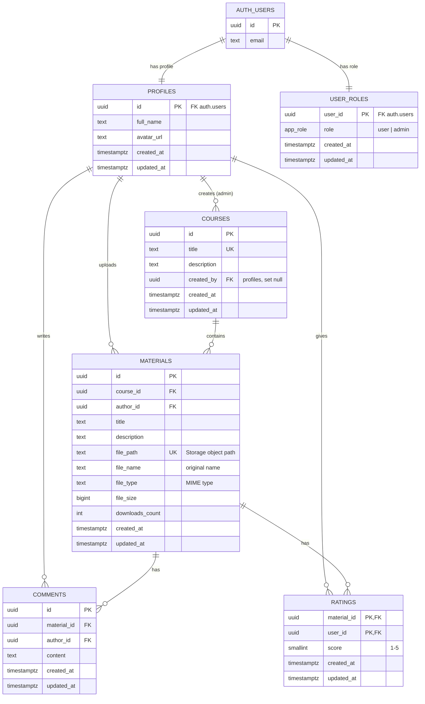

# StudyShare

A web app for sharing study materials by course. Students upload lecture notes, solved exercises and slides (PDF / DOCX / PPTX), download others' materials, comment and rate them. Admins manage courses, moderate content and assign roles.

> 🚧 Work in progress — capstone project for the SoftUni course “Software Technologies with AI”.

**Live demo:** https://studyshare-learn.netlify.app (demo accounts are listed [below](#demo-accounts)).

## Features

- Browse courses and their materials (search, sorting by date, rating, downloads, title) — no login needed.
- Upload materials (PDF, Word, PowerPoint, Excel, TXT, ZIP up to 20 MB) to a course; edit or delete your own.
- Download files (logged-in users), with a download counter.
- Comment (add, edit, delete your own) and rate materials with 1–5 stars (not your own).
- Profile with avatar upload and name editing; personal dashboard with statistics.
- Admins: manage courses, moderate any material or comment, assign roles.

## Tech stack

- **Frontend:** HTML, CSS, vanilla JavaScript (ES modules), Bootstrap 5, Bootstrap Icons
- **Build:** Node.js, npm, Vite
- **Backend:** Supabase (Postgres DB, Auth, Storage)
- **Hosting:** Netlify

## Architecture (short)

- Single `index.html` shell + client-side router (`src/router.js`, History API) with clean URLs.
- Each page is a separate folder in `src/pages/` (HTML fragment + CSS + JS), loaded on demand.
- All data access goes through services in `src/services/`; authorization is enforced by Supabase RLS.

### Routes

| Route | Page | Access |
|---|---|---|
| `/` | Landing page | everyone |
| `/login`, `/register` | Login / registration | guests |
| `/dashboard` | User dashboard | users |
| `/courses`, `/courses/:id` | Courses and their materials | everyone |
| `/materials/add`, `/materials/:id/edit` | Upload / edit material | users |
| `/materials/:id` | Material details | everyone |
| `/profile` | My profile | users |
| `/admin?tab=users\|courses\|moderation` | Admin panel | admins |

### Admin panel

- **Overview:** totals for users, admins, courses, materials, comments and downloads.
- **Users:** list with email, role and activity, search and role filter; grant or revoke the admin role (with confirmation).
  An admin cannot change their own role, so at least one admin always remains.
- **Courses:** create, edit and delete. Deleting a course removes its materials, comments and ratings (DB cascade) and their files in Storage.
- **Moderation:** the latest 20 materials and comments site-wide, each deletable.

Security is enforced in the database, not in the browser:
- `admin_list_users()` and `admin_get_stats()` are `SECURITY DEFINER` functions that check `public.is_admin()` first. They return only the needed fields (emails come from `auth.users`, which clients cannot read).
- Role changes go through `user_roles` and its RLS policy (admins only, never on their own row). Users can never promote themselves.

## Local development

```bash
git clone https://github.com/plam13/studyshare.git
cd studyshare
npm install
cp .env.example .env   # fill in VITE_SUPABASE_URL and VITE_SUPABASE_PUBLISHABLE_KEY
npm run dev
```

## Deployment (Netlify)

- Build settings are in `netlify.toml` (`npm run build` → `dist/`); `public/_redirects` sends every route to `index.html`, so clean URLs such as `/materials/<id>` work on reload.
- Environment variables on Netlify: `VITE_SUPABASE_URL`, `VITE_SUPABASE_PUBLISHABLE_KEY` (public values only).
- Supabase Auth → URL configuration: Site URL `https://studyshare-learn.netlify.app`, redirect URLs for the live site and `http://localhost:5173/**`.
- Manual deploy with the Netlify CLI: `netlify deploy --build --prod`.

## Files and storage

- `materials` bucket (private): object path `<uploader-id>/<uuid>-<safe-name>`; the original file name is kept in `materials.file_name` and used when downloading. Only logged-in users can download.
- `avatars` bucket (public): `<user-id>/avatar-<timestamp>.<ext>`; old avatar files are removed when replaced.
- Deleting or replacing a material also deletes its file — database cascades do not remove Storage objects.

## Database schema



- **`profiles`** is 1:1 with `auth.users` and is created by the `on_auth_user_created` trigger together with a default `user` row in **`user_roles`**. Roles never come from sign-up metadata.
- **`materials`**, **`comments`** and **`ratings`** are deleted in cascade with their course, material or author. Storage files are removed by the app (cascades do not delete Storage objects).
- **`ratings`** uses a composite primary key `(material_id, user_id)`, so each user rates a material at most once. An RLS policy blocks rating your own material.
- **`material_stats`** (view, `security_invoker`) aggregates the average rating, ratings count and comments count per material.
- **Indexes** on every foreign key (`course_id`, `author_id`, `material_id`, `user_id`, `created_by`), on `materials.created_at` for "latest" lists and on `user_roles.role`. Check constraints limit text lengths and the 1–5 score.
- **RLS** is enabled on every table; `public.is_admin()` is used by admin policies. Clients can update only allowed columns (column-level grants), e.g. never `author_id` or `downloads_count`.

## Database workflow

The DB schema is managed only through SQL migrations in `supabase/migrations/`, using the **Supabase CLI** linked to the remote project (`npx supabase link`). No schema changes are made by hand in the dashboard, so the migration files in this repo are the full history of the database.

```bash
npx supabase migration new <name>          # create a new SQL migration file
npx supabase db push --remote --dry-run    # preview what will be applied
npx supabase db push --remote              # apply it to the Supabase project
npx supabase migration list --remote       # check that local and remote history match
```

| Migration | What it does |
|---|---|
| `init_schema` | tables `profiles`, `user_roles`, `courses`, `materials`, `comments`, `ratings`, view `material_stats`, indexes |
| `rls_policies` | RLS on every table, `is_admin()` helper, column-level grants |
| `seed_admin_role` | assigns the admin role to the bootstrap admin account |
| `storage_buckets` | `avatars` (public) and `materials` (private) buckets and their policies |
| `dashboard_stats_rpc` | personal dashboard statistics function |
| `download_counter_rpc` | safe download counter increment |
| `ratings_no_self_rating` | users cannot rate their own materials |
| `admin_users_rpc` | admin-only user list and site statistics |

How the parts talk to Supabase:
- **Frontend:** `@supabase/supabase-js` (REST API) with the public publishable key; access is limited by RLS.
- **Schema:** Supabase CLI migrations (above).
- **Sample data:** the Node.js seed script below, using the secret key on the server side only.

## Sample data (seed)

The seed script creates demo users (through the Supabase Auth Admin API), courses, materials with sample PDF files in Storage, comments and ratings. It is safe to rerun: existing records are skipped and passwords are never reset.

It also uploads 15 real slide decks from SoftUni courses (`scripts/seed-softuni.mjs`). The PDFs are read from a local `pdf/` folder, which is git-ignored and never committed. If a file is missing, it is skipped with a warning. Each of these materials keeps its original file name and its description ends with „Източник: SoftUni“.

```bash
cp .env.server.example .env.server.local   # server-side only: SUPABASE_URL, SUPABASE_SECRET_KEY, SEED_EXPECTED_PROJECT_REF
npm run seed:dry-run                        # shows what would be created, writes nothing
npm run seed                                # applies the seed
```

> The secret key is used only by Node.js scripts in `scripts/`. It never has a `VITE_` prefix and never reaches the browser.

## Demo accounts

| Role | Email | Password |
|---|---|---|
| Admin | `admin@studyshare.bg` | `********` (provided in the project submission) |
| User | `demo@studyshare.bg` | `demo123` |
| User | `maria@studyshare.bg`, `peter@studyshare.bg`, `elena@studyshare.bg` | `pass123` |

## Project structure

```
├── index.html             # app shell
├── public/                # static assets (favicon, Netlify _redirects)
├── src/
│   ├── main.js            # entry: global CSS/JS, layout, auth init, router start
│   ├── router.js          # routes, guards, mount/unmount
│   ├── styles.css         # global styles entry (imports src/styles/*)
│   ├── styles/            # design tokens, base, Bootstrap theme, shared ss- blocks
│   ├── pages/<page>/      # page fragment (.html) + styles (.css) + logic (.js)
│   ├── components/        # header, footer, cards, SVG illustrations, material banner, …
│   ├── services/          # Supabase client, auth and data services
│   └── utils/             # escaping, validation, toasts, guards
├── supabase/migrations/   # DB migrations (SQL)
├── scripts/               # server-side Node.js scripts (seed)
├── .github/copilot-instructions.md   # AI agent instructions
└── vite.config.js
```
